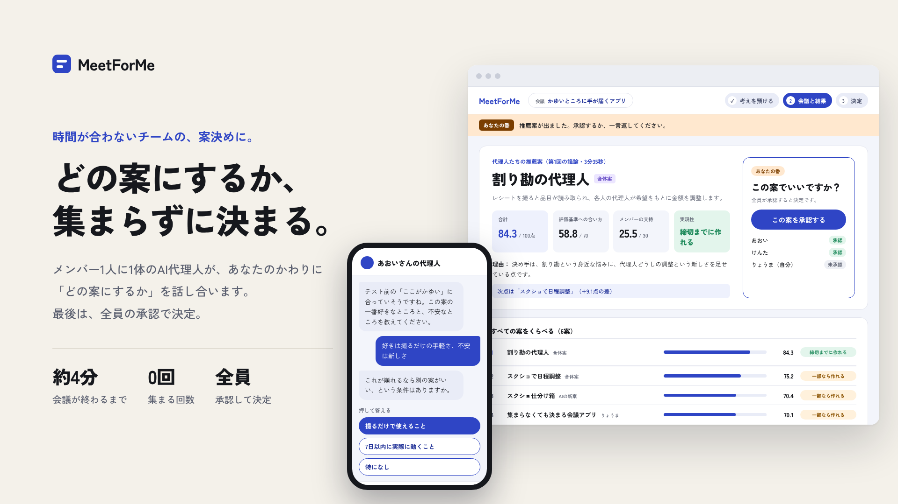
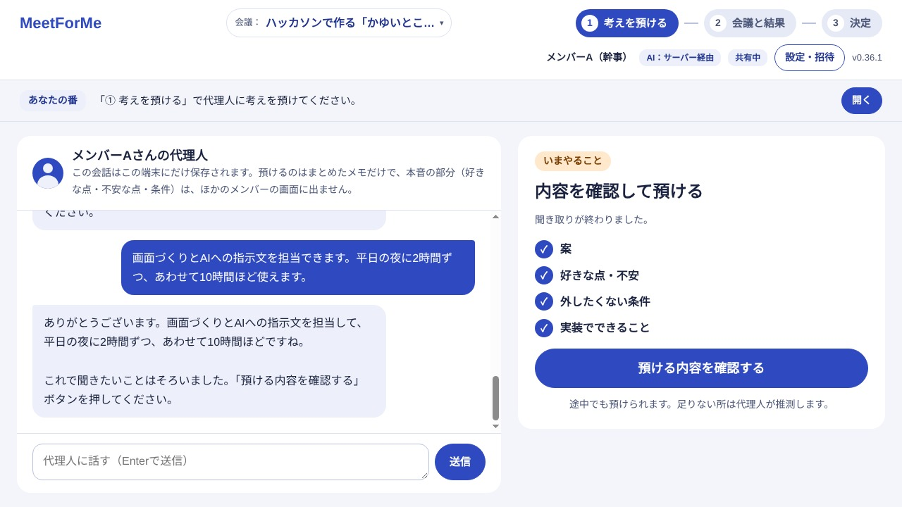
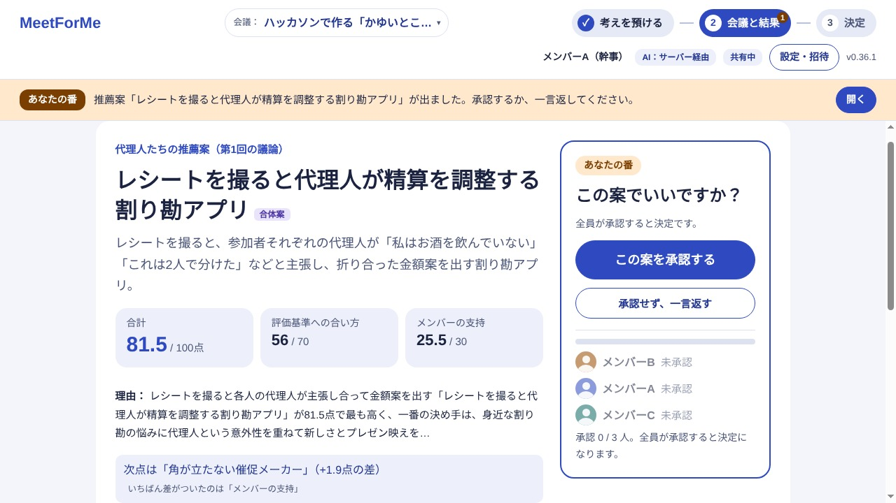
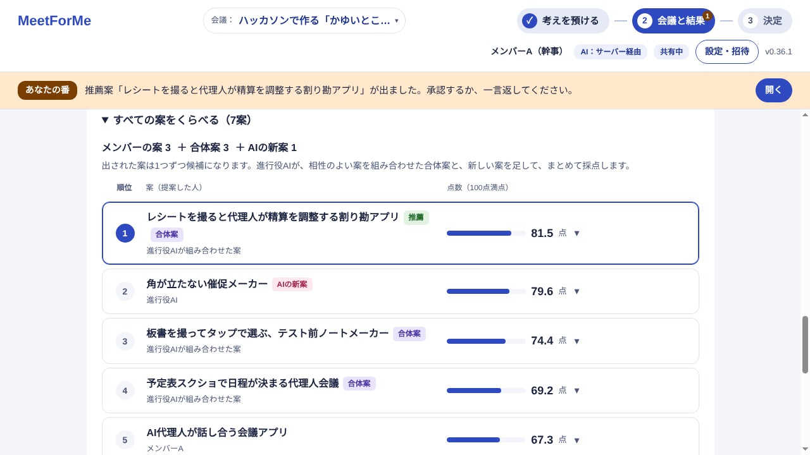

# MeetForMe



**集まらなくても決まる、AI代理会議。** メンバー1人に1体ずつAIの代理人が付き、あなたが留守の間に、「どの案にするか」を決める会議を本人のかわりに進めるアプリです。（旧名：るす番会議・かわりに会議）

- **Web版（インストール不要）**：https://meetforme.vercel.app/ （スマホ・Mac・Windowsのブラウザ）
- **デスクトップ版（Windows）**：`dist\meetforme-setup-（バージョン）.exe`
- **デモ動画（YouTube）**：https://www.youtube.com/watch?v=5JVYGNUDQA4
- ShipLab Hackathon 2026（テーマ「かゆいところに手が届くアプリ」）の提出作品です。
- **チーム**：RememBug Me（3人）
- **このリポジトリのバージョン**：v0.39.4

## このアプリが生まれた背景

このハッカソンで、私たち自身に起きたことがきっかけです。

キックオフのあと、3人とも案はすぐに出しました。ところが、それぞれに用事があってなかなか集まれず、「どの案にするか」を最終的に決める場がないまま、時間だけが過ぎていきました。案を出すことよりも、1つに決めることのほうが難しかったのです。

この実体験から、集まらなくても案を決められる MeetForMe を作りました。

## 何に困っていたか

- **予定が合わない**：授業、バイト、夜型と朝型。3人そろう時間を探すだけで数日かかります。
- **声の大きい人の案になる**：やっと集まっても、よく話す人の案に流れて決まりがちです。
- **本音を言いにくい**：「その案は少し不安」が、面と向かうと言い出せません。

集まれるなら、集まって話すのが一番です。MeetForMe は、集まりたいのに時間が合わないチームのための道具です。日程調整のアプリが決めるのは「いつ集まるか」ですが、MeetForMe は集まらずに「どの案にするか」まで決めます。

## どう解決するか

1. **考えを預ける（約2分）**：好きな時間に、自分の代理人（AI）へ案と本音を話します。質問は4つほどです。
2. **代理人どうしが会議（数分・見ているだけ）**：全員が預けると自動で始まり、推薦案が出ます。
3. **承認して決定（約1分）**：推薦案を見て、全員が承認すれば決まりです。最後に決めるのは人間です。

## テーマ「かゆいところに手が届く」との関係

「案は出たのに、決める場だけが開けない」。この小さな、でも毎回起きるかゆみに絞りました。日程調整アプリは「いつ集まるか」を決めてくれますが、集まらずに「どの案にするか」を決める道具は見当たりませんでした。MeetForMe は、その手が届いていなかった部分を埋めます。

- **預ける作業は2分ほど**：質問は4つほど。選択肢を押すだけでも答えられます。
- **あとは見ているだけ**：会議は代理人が進めます。
- **決めるのは人間**：推薦は出しますが、最後は全員の承認です。

## すぐに試す

### Web版で試す

1. https://meetforme.vercel.app/ を開き、「代表者として始める」で名前とテーマを入れて会議を作ります。
2. 「設定・招待」の「招待の文とリンクをコピー」で、メンバーにリンクを送ります。開くと、招待コードが入った状態で参加の画面が出ます。
3. それぞれ「① 考えを預ける」で代理人に話して預けます。全員が預けると、会議が始まります。

- 会議を進めるのは代表者の画面です。会議が終わるまで、代表者はページを開いたままにしてください。
- AIを呼ばずに画面の流れだけを見たいときは、「設定・招待」→「上級者向けの設定」の「見本モード」にチェックを入れます（応答は決まった見本になります）。
- このURLからは本物のAIが動き、利用分は開発者の負担になります。URLと招待コードは、関係者の外に広めないでください。

### デスクトップ版で試す（Windows）

1. `dist\meetforme-setup-（バージョン）.exe` をダブルクリックします。署名をしていないので、初回は「WindowsによってPCが保護されました」と出ます。「詳細情報」→「実行」で進めます。
2. インストールが終わると、デスクトップとスタートメニューに「MeetForMe」ができます。
3. 起動して、会議を作るか、8文字の招待コードで参加します。

Web版の人とデスクトップ版の人は、同じ会議に入れます。

## 画面イメージ

動かさなくても流れが分かるように、3つの場面を載せます。画像をクリックすると大きく表示されます。名前は「メンバーA・B・C」に置き換えています。会議の中身は、本物のAIで実際に行ったものです。

| ① 代理人に考えを預ける | ② 推薦案と理由が出る | ③ すべての案をくらべる |
| :---: | :---: | :---: |
| [](docs/screenshots/01-deposit.jpg) | [](docs/screenshots/02-recommend.jpg) | [](docs/screenshots/03-compare.jpg) |
| 聞き取りが終わると、預ける内容を確認できます | 結論を先に見せ、全員が承認すると決定です | 本人の案・合体案・AIの新案を、同じ基準で採点します |

## 主な機能

- **個室で考えを預ける**：代理人との会話で、案・好きな点・不安な点・外せない条件を預けます。押すだけで答えられる選択肢つきです。
- **代理人どうしの会議**：発言がリアルタイムに流れ、合体案や新しい案も出ます。
- **採点と推薦**：結論（推薦案・理由・次点との差）を先に見せ、内訳は「くわしく見る」に入れています。採点は2回行って平均します。
- **預ける締切**：締切を過ぎたら、預けた人だけで会議が始まります。
- **確認と承認**：判断しにくかった点だけ本人に質問が届き、全員が承認すると決定です。
- **別の端末で続ける**：PCで始めた会話を、引き継ぎリンクでスマホから続けられます。

くわしくは [機能と会議の仕組み](docs/FEATURES.md) を見てください（会議の5つの段階、採点のルールも載せています）。

## AIの使い方・工夫

AIに任せすぎず、「AIが得意なこと」と「ルールで決めること」を分けています。

- **1人に1体の代理人**：本人の案と本音を、個室の会話から預かります。会議では、その人の立場で主張します。
- **進行役AIが、案の外側を担当**：合体案や新しい案を出し、各案が締切までに作れるかも検討します。
- **採点は、誰の案かを伏せて行う**：声の大きい人や、AIの新案が有利にならないようにしています。
- **採点は2回行って平均**：2回で1位が入れ替わるときは僅差として、全員に聞き直します。
- **合計点と順位は、AIではなくルールで計算**：AIが受け持つのは、基準ごとの採点と理由の説明だけです。
- **根拠を見せる**：点ごとに「案のどの記述からそう判断したか」を1文で付けます。次点との差は、点数からそのまま計算して表示します。
- **本音の扱い**：決定すると、預けた本音は共有の保存先から自動で消えます。

## 仕組み

```
アプリ（Web版 / デスクトップ版）
   │  画面と会議の処理は同じコード（src/）
   ▼
Supabase
   ├─ 会議の保存（Postgres）：招待コードを知っている人だけが読み書きできる
   └─ AIの中継（Edge Function「claude」）：1日の回数に上限を付けて Claude を呼ぶ
        ▼
     Claude API（APIキーは中継のサーバーだけが持つ）
```

- **アプリ**：HTML・CSS・JavaScript（フレームワークなし）。デスクトップ版は Electron、Web版は静的なファイルを Vercel に置いています。
- **保存先**：Supabase の Postgres。表は `docs` 1つで、行ごとの制限（`docs_by_room`）により、会議の番号（＝招待コード）を知っている人だけが読み書きできます。
- **AI**：Claude（既定は `claude-sonnet-5-5`）。Supabase の Edge Function が中継し、会議ごと1日200回・全体1日1000回の上限を付けています。
- **招待コード**：8文字（例：`K7M2-9QXD`。まぎらわしい 0・1・I・O は使いません）。

## データの扱い

- 代理人との会話と下書きは、自分の端末にだけ保存されます。
- 預けた内容（まとめたメモ）は、会議を進めるために共有の保存先に置かれます。本音の部分は、ほかのメンバーの画面には出ません。
- ただし、**招待コードを知っている人は、技術的には保存先を読めます。** 招待コードはチームの外に渡さないでください。
- **決定すると、預けた本音（好きな点・不安な点・外したくない条件・実装でできること）と、代理人からの確認のやり取りは、共有の保存先から自動で消えます。** 残るのは、会議で公開された案・発言・採点・決定だけです。決定を取り消したときは、各自の端末から自動で預け直されます。
- 預けた内容は、AIの応答を得るために Claude の API に送られます。
- ClaudeのAPIキーは、アプリにもリポジトリにも入っていません。
- くわしくは `PRIVACY.md` と `TERMS.md`（どちらも下書きです）。

## わかっている制限

- 本物のAIでの通し確認は、まだ回数が少ないです（公開中のWeb版で、3人の会議を決定まで通しました）。
- 会議は、代表者のページを開いている間に進みます。サーバーで進める関数は作成済みですが、本物のSupabase上ではまだ通し確認していません。
- ページを閉じているときの通知（プッシュ通知）は、まだありません。
- デスクトップ版は署名がなく、Windows専用です。

ほかの制限は [わかっている制限（詳細）](docs/LIMITATIONS.md) にまとめています。

## 仮想ユーザーによる評価

AIに100人の人物像（想定外の人や否定的な人を約3割）を設定させ、同じ100人の反応を4回推定して、改善に使いました。**実際のユーザー調査ではありません。**

| | 1回目（v0.28.0） | 4回目（v0.35.0） |
| --- | --- | --- |
| 人に勧める度合い：時間が合わないチーム41人の平均（0〜10） | 7.1 | 8.3 |
| 人に勧める度合い：100人全体の平均（0〜10） | 5.18 | 6.51 |
| 途中で使うのをやめた人（100人中） | 21人 | 12人 |

4回目では、100人のうち82人が1回目より評価を上げ、下げた人はいませんでした。全体の平均が低めなのは、集まって話せる人や対象でない人も入れてあるためです。2・3回目の数字、直した点、残った不満は [評価の詳細](docs/EVALUATION.md) にあります。

## 今後の展開

1. **提出後すぐ**：会議をサーバー側で進めて、「預けたらページを閉じていい」を本番に入れます（関数は作成済み）。実際のチームに使ってもらい、評価を取り直します。会議中の本音の守りも強くします。
2. **その次**：iOSとAndroidのアプリとして、App Store と Google Play に申請します。結果が出たら通知で知らせます。
3. **その先**：ハッカソンの案決めだけでなく、サークルの企画、授業のグループワーク、仕事の方針決めにも使える形にします。

## ドキュメント

- [機能と会議の仕組み](docs/FEATURES.md)：機能、会議の5つの段階、採点のルール
- [仮想ユーザーによる評価](docs/EVALUATION.md)：4回の評価の数字と、直した点
- [わかっている制限](docs/LIMITATIONS.md)
- [開発者向けガイド](docs/DEVELOPMENT.md)：動かし方、テスト、公開、自分の Supabase、ファイル構成
- [PRIVACY.md](PRIVACY.md) / [TERMS.md](TERMS.md)：データの扱いと利用上の注意（下書き）

## ライセンス

`LICENSE` を参照してください。
